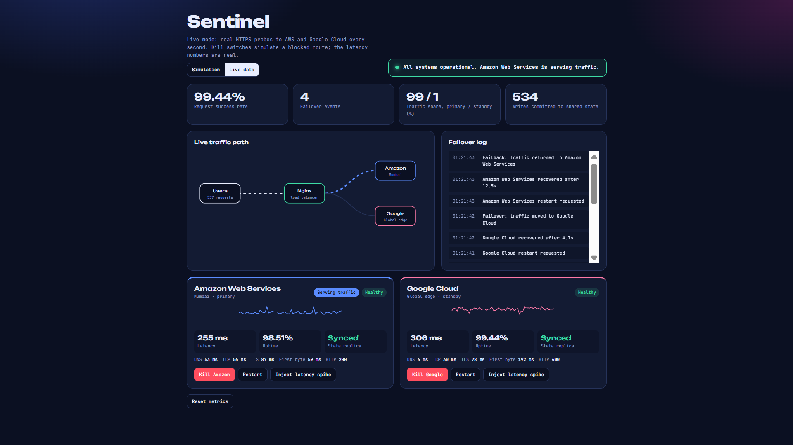
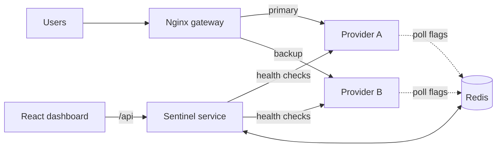

# Sentinel: Cloud Resilience Monitor


A multi-cloud failover monitor. It health-checks two cloud providers every second, automatically reroutes traffic when one fails, and shows uptime, latency, failover events and state-sync status on a live dashboard. A kill switch lets you cause an outage on demand and watch the system recover.



## Features

- **Two modes:** Simulation (two mock cloud providers you can kill) and Live (real HTTPS probes to AWS and Google Cloud endpoints)
- **Automatic failover and failback** through Nginx, with a timestamped failover log
- **Kill switch, restart button and latency-spike injection** to test outages on either provider
- **Live-mode latency breakdown:** DNS, TCP, TLS and time to first byte
- **History charts:** 1h / 24h / 7d uptime bars and a latency graph, saved across restarts
- **Measured failover and detection times (MTTD)** from kill-switch tests
- **Discord alerts** for failed checks, failovers and recoveries (optional)
- **CSV export** of the event log and 24h history
- **Redis-outage resilience:** providers keep serving traffic and keep the last known kill flag when Redis is down
- **Automated tests** and GitHub Actions CI
- **State-sync panel** showing a provider catching up after recovery (simulated, see below)

## Architecture



| Service                    | Technology     | Role                                                                                                  |
| -------------------------- | -------------- | ----------------------------------------------------------------------------------------------------- |
| `provider_a`, `provider_b` | Python (Flask) | Mock cloud providers (about 35 ms and 70 ms base latency)                                             |
| `gateway`                  | Nginx          | Load balancer: sends traffic to A, retries on B when A errors or times out. Also serves the dashboard |
| `sentinel`                 | Python (Flask) | Health checks every second, failover tracking, history, alerts, control API                           |
| `redis`                    | Redis 7        | Kill flags, counters, history and event log (saved to a Docker volume)                                |
| Dashboard                  | React          | Live view and control buttons                                                                         |

## Run it

Requires [Docker Desktop](https://www.docker.com/products/docker-desktop/).

```
docker compose up --build
```

Then open http://localhost:8080

Stop with `Ctrl + C`, then `docker compose down` (history is kept in the `redisdata` volume).

### Optional: Discord alerts

1. In Discord, create a webhook for a channel (Edit Channel, Integrations, Webhooks).
2. Copy `.env.example` to `.env` and set `DISCORD_WEBHOOK_URL=<your webhook URL>`.
3. Restart Sentinel: `docker compose up -d --force-recreate sentinel`

`.env` is in `.gitignore`. Never commit a webhook URL.

### Optional: change the Live-mode targets

Live mode probes `https://dynamodb.ap-south-1.amazonaws.com/ping` and `https://storage.googleapis.com/` by default. To change them, add `LIVE_URL_A` and `LIVE_URL_B` under `sentinel:` `environment:` in `docker-compose.yml`. Any HTTPS URL works, and any response below HTTP 500 counts as reachable.

## Try it

1. Click **Kill Nimbus**. Within about a second the health check fails, traffic moves to Stratus, and the failover log fills in.
2. Click **Restart**. Nimbus recovers, traffic fails back, and the state-sync panel shows it catching up.
3. Switch to **Live data** to see real latency measured against public cloud endpoints. In Live mode the kill button simulates a blocked route, since you cannot switch off AWS.

Useful terminal commands:

| Command                                        | What it does                                                  |
| ---------------------------------------------- | ------------------------------------------------------------- |
| `docker compose ps`                            | Lists the containers                                          |
| `docker compose logs sentinel --tail 15`       | Last 15 Sentinel log lines                                    |
| `curl.exe http://localhost:8080/work`          | Sends one request through Nginx (prints the serving provider) |
| `curl.exe -i http://localhost:8080/api/status` | Reads Sentinel's status API                                   |
| `docker compose stop redis` / `start redis`    | Simulates a Redis outage                                      |

## How it works

When you press **Kill**:

1. The dashboard calls the Sentinel API, which sets a kill flag for that provider in Redis and records the time.
2. Each provider refreshes its flags from Redis in a background thread every 0.2 s. A killed provider starts returning HTTP 503.
3. Nginx retries failed requests on the backup provider, so users usually still get answers.
4. Sentinel's next health check fails. It marks the provider down, switches the active provider, logs the failover and sends a Discord alert if configured.
5. After **Restart**, the next check succeeds, traffic fails back, and the provider catches up on writes.

## Measured results

- **Before the Redis-outage fix:** average failover time of 0.6 s over 28 kill-switch tests in Simulation mode.
- **After the fix,** the kill flag can reach a provider up to 0.2 s later, so these numbers are being re-measured. Early samples after the change were about 1.2 s (only 2 tests).
- **What "failover time" means:** the time from pressing Kill to Sentinel switching its routing decision. It is not user-visible downtime, because Nginx retries failed requests on the backup immediately.
- Health checks run once per second, so timings have about 1 s resolution.
- The **recovery time (MTTR)** card is dominated by how long you wait before pressing Restart, so treat it as informational.

## Resilience testing: what Redis down does

Found by testing, and fixed:

|                                     | Before the fix                    | After the fix                  |
| ----------------------------------- | --------------------------------- | ------------------------------ |
| `GET /work` with Redis stopped      | Hung, then Nginx returned **504** | **200 in about 0.05 s**        |
| Killed provider while Redis is down | Not tested                        | **Stays killed** (cached flag) |

The cause was that each provider read Redis on every request with no timeout. Providers now read flags from memory, refreshed by a background thread, and keep the last known value if Redis is unreachable.

## Known limitations

- **Redis is a single instance.** While it is down, the dashboard and Sentinel API return errors (HTTP 500), history stops recording, and pressing Kill has no effect because the button also goes through Redis.
- **Nginx is a single instance.**
- **Nginx caches provider addresses at startup.** If you rebuild or recreate a provider, run `docker compose restart gateway` or requests return 502.
- **State sync is simulated.** It is a counter that shows a provider catching up after recovery, not real database replication.
- **No per-request tracing yet.** It is not possible to tell whether a failed request was already in flight when Kill was pressed or arrived during the switchover.
- **Simulation mode providers are mock services,** and in Live mode the outages are still simulated.

## Tests and CI

Seven pytest tests (failover and failback, total outage, failover timing, state sync, history maths, status API, CSV export) run on every push with GitHub Actions. They use a fake Redis, so they check routing logic but do not kill a real container behind Nginx. The Redis-outage behaviour above was verified manually and is not yet covered by an automated test.

Run locally:

```
pip install -r services/requirements.txt fakeredis pytest
pytest -q
```

## Project structure

```
.
├── docker-compose.yml
├── nginx/nginx.conf          # load balancer and static hosting
├── services/
│   ├── provider.py           # mock cloud provider
│   ├── sentinel.py           # monitor and API
│   ├── Dockerfile
│   └── requirements.txt
├── dashboard/index.html      # React dashboard
├── tests/test_sentinel.py
├── .github/workflows/ci.yml
├── docs/dashboard.png
└── .env.example
```

## Troubleshooting

- **`docker` is not recognized or the engine is stopped:** open Docker Desktop and wait for "Engine running".
- **Port 8080 is in use:** change `"8080:80"` in `docker-compose.yml`.
- **502 after rebuilding a provider:** `docker compose restart gateway`.
- **Dashboard shows "Can't reach the Sentinel API":** wait about 10 seconds after startup and refresh.

## Roadmap

- Automated test for the Redis-down behaviour and an end-to-end failover test through Nginx
- Per-request tracing to separate in-flight failures from switchover failures
- Re-measure failover time after the Redis fix
- Measure recovery time from restart to healthy instead of from the Restart click
- Prometheus and Grafana metrics
- Real Redis replication instead of simulated sync
- Circuit breaker with gradual traffic return
- Dynamic DNS resolution in Nginx so provider restarts do not need a gateway restart

## License

MIT

## Author

Tanish Kesharwani
[LinkedIn](https://linkedin.com/in/tanish-kesharwani) · [GitHub](https://github.com/tkesharwani285-design)
