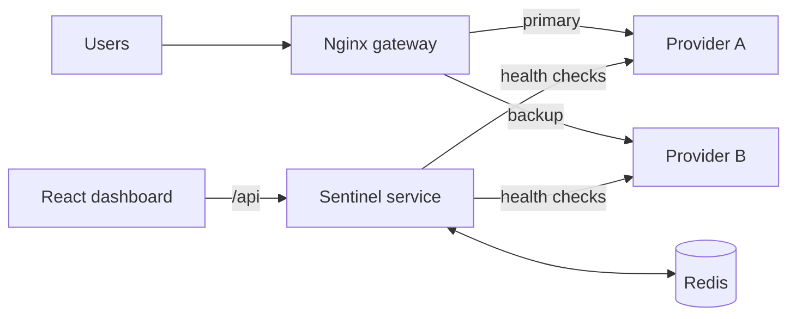

# Sentinel: Cloud Resilience Monitor

A multi-cloud failover monitor. It health-checks two cloud providers every second, automatically reroutes traffic when one fails, and shows uptime, latency, failover events and state-sync status on a live dashboard.


## Features
- **Two modes:** Simulation (two mock cloud providers) and Live (real HTTPS probes to AWS and Google Cloud)
- **Automatic failover and failback** through Nginx, with a timestamped failover log
- **Kill switch** to simulate an outage on either provider, plus a restart button
- **Latency breakdown** in Live mode: DNS, TCP, TLS and time to first byte
- **Latency spike injection** in Simulation mode
- **State-sync tracking** that shows a provider catching up after recovery (simulated)
- **React dashboard** with a live traffic-path diagram, uptime and request success rate

## Architecture


## Tech stack
Python (Flask), Redis, Nginx, React, Docker Compose

## Run it
Requires Docker Desktop.

```
docker compose up --build
```

Then open http://localhost:8080

## Try it
1. Click **Kill** on the primary provider and watch traffic fail over to the standby.
2. Click **Restart** and watch it recover and fail back.
3. Switch to **Live data** to see real latency measured against public cloud endpoints.

## How it works
- **Providers:** two small Flask services act as mock clouds. Outages and latency are controlled through flags in Redis.
- **Sentinel:** checks each provider every second, records uptime, latency and events in Redis, and exposes a control API.
- **Nginx:** routes traffic to Provider A and falls back to Provider B when A returns errors or times out.
- **Dashboard:** a React page that polls the Sentinel API once per second.

## Roadmap
- Persistent history and uptime-over-time charts
- Discord and Telegram alerts
- Prometheus and Grafana metrics
- Real Redis replication instead of simulated sync
- Automated tests and CI with GitHub Actions

## Author
Tanish Kesharwani
[LinkedIn](https://linkedin.com/in/tanish-kesharwani) · [GitHub](https://github.com/tkesharwani285-design)